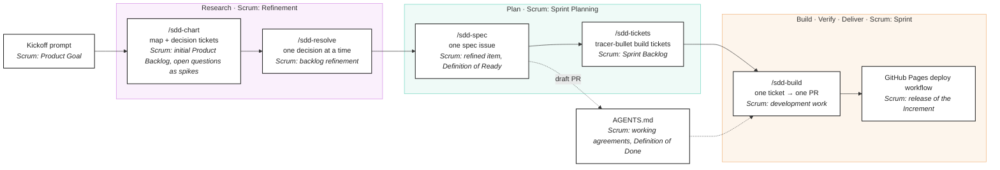

## Prompting

### Initial Prompt

```
I want to create a web app that allows people to create rooms and play checkers and tic-tac toe online. For that I am thinking of using peer-js (WebRTC) library. I don't want to setup a backend, it should be client-side only. I want to host the website through GitHub pages. Perhaps we start only with tic tac toe since it's a more simple game than checkers. I want the game implemented from scratch without using any libraries (we code the game ourselves) so we have full control. Users should be able to enter the website, choose the game (checkers or tic-tac-toe), create a room after entering their name, which will generate a dynamic route, and then they can share with their friends, which can join the room with their name. I want them to be able to choose an emoji as an avatar. Let's use React for the web app. We have one hour to implement the first version of the app: the first version is what should be mapped here.
```

### Good prompting

A good prompt sections:
- Goal and why
- Context
- Done when
- Limits
- Example
- How to work
- Output and check


#### Example of good output:
```md
## Goal and why
Build the first version of a web app where people create rooms and play tic-tac-toe online with friends.
We want a game platform that costs nothing to run: no backend, hosted on GitHub Pages. We write the game logic ourselves so we fully control it. Tic-tac-toe comes first because it is simpler. Checkers comes later, and the design should leave room for it.

## Context
- Stack: React for the UI, PeerJS (WebRTC) for peer-to-peer connections.
- Client-side only. There is no server of our own, and PeerJS's public signaling server is acceptable.
- Hosting: GitHub Pages (a static build).
- The game rules and board are written from scratch. No game libraries.
- The time box is **1 hour** for this first version.

## Done when
1. A user opens the site and sees a game picker with tic-tac-toe and checkers. Checkers is visible but marked "coming soon".
2. The user enters a name, picks an emoji avatar and creates a room. This opens a dynamic route (for example `#/room/<roomId>`) that can be shared as a link.
3. A friend opens the link, enters their own name and emoji, and joins the room.
4. Both players see each other's name and avatar and play tic-tac-toe in real time. Turns are enforced, and the game detects a win or a draw.
5. Players can start a rematch in the same room.
6. The app builds and works when deployed to GitHub Pages.

## Limits
- No backend, database or authentication.
- No game or board libraries.
- Rooms hold 2 players. Spectators, chat and persistence are out of scope.
- Checkers is not implemented in v1. Only the selection option and the extension point exist.
- Use routing that works on GitHub Pages (hash routing, or a 404.html fallback).
- Keep dependencies to React, PeerJS and the build tool.

## Example
Ana opens the site, picks tic-tac-toe, types "Ana", chooses 🦊 and clicks **Create room**. She lands on `/#/room/k3x9` and copies the link to Bruno. Bruno opens it, types "Bruno", chooses 🐼 and joins. Both screens show "🦊 Ana (X) vs 🐼 Bruno (O)" with Ana to move. Ana wins on the diagonal, both screens show "🦊 Ana wins!" and a **Rematch** button.

## How to work
- Plan briefly before coding, then build in thin vertical slices: routing and the lobby, then the PeerJS connection, then the game logic, then the sync between players.
- Keep the game logic in pure, framework-free functions (state, move, winner) so checkers can reuse the same pattern.
- The room creator is the host and is the authoritative source of game state. The guest sends moves, and the host validates them and broadcasts the new state.
- When a decision is unclear, choose the simplest option that meets "Done when", and note it.

## Output and check
- Output: a working React app in this repo, a short README section on running it locally and deploying it, and a list of the decisions you made and the known limitations.
- Check:
  - Unit-test the tic-tac-toe logic for wins, draws and invalid moves.
  - Test manually with two browser windows: create a room, join it, play to a win and to a draw, then rematch.
  - Run a production build and confirm the room link works on the GitHub Pages URL.
```

## SDD Skills

### Phase by phase
| SDD phase | What it does | Course step | Scrum | Human gate |
|-|-|-|-|-|
| `/sdd-chart` | Grills the destination and the open decisions, breadth first.<br>Publishes the map and one ticket per decision;<br>starts research subagents in the background. | **Research**<br> Frame step: agree the question and what's out of scope. | **Refinement**<br> The map's Destination plays the Product Goal. | Confirm destination, time box and ticket list |
| `/sdd-resolve` | Settles one decision per run:<br> grills a person on `sdd:grilling`, summarises findings on `sdd:research`.<br> Writes the decision, why, and what it means for the spec. | **Research**<br> Explore, Challenge, Write.<br>Grilling is the Interview pattern. | Refinement<br>Breaking down and further defining items. | Decide each grilling question; facts are the agent's job |
| `/sdd-spec` | Synthesises every decision into one spec issue (problem, stories, modules, testing, assumptions).<br>Opens a draft PR with an AGENTS.md proposal. | **Plan**<br> Spec-driven development and a minimal spec.<br>AGENTS.md. | **Refinement**<br>Items get ready for Sprint Planning. | Correct the spec; review the AGENTS.md PR |
| `/sdd-tickets` | Slices the spec into tracer-bullet tickets, each end to end and demoable,  sized to one agent session, wired with blocked-by edges. | **Plan**<br>Split until each task can  be reviewed in one sitting. | **Sprint Planning**<br>Decompose items into small work;<br>the result is the Sprint Backlog. | Approve granularity and edges (the team accepts the plan) |
| `/sdd-build` | Claims one unblocked ticket,<br>works in a fresh worktree,<br>writes logic test first,<br>runs every acceptance criterion,<br>opens a PR that says how each was checked. | **Build**<br> one small task at a time.<br>**Verify**<br>AI checks its own work first. | **Sprint**<br>The tracker's frontier is what the Daily Scrum looks at. | None inside; it stops at the PR |
| **Review & Merge** | A person reads intent and risk and merges.<br>The merge closes the ticket and unblocks the next ones. | **Verify & review**<br>A person who didn't write it approves. | **Definition of Done**<br>An Increment is born. | Approve the PR |


### Overview



### The same artifacts, three names

| Scrum artifact | SDD on GitHub | Course: what the step leaves |
|-|-|-|
| Product Goal | `sdd:map` Destination and Out of scope | The intent: problem, outcome, constraints |
| Product Backlog | Decision tickets, then the `sdd:spec` user stories | The intent's open questions, then the spec  |
| Sprint Backlog | `sdd:build` tickets with blocked-by edges | The plan: small tasks, in order, with the tests that prove each |
| Increment | Merged PR that closes its ticket, criteria ticked | An approved pull request |
| Definition of Ready (team practice) | Ticket unblocked, criteria checkable in a browser | or a test | Plan's people check |